# Terrascope

[](https://github.com/a-shygun/Terrascope/actions/workflows/ci.yml)
[](https://pypi.org/project/Terrascope/)
[](https://pypi.org/project/Terrascope/)
[](LICENSE)


`terrascope` is an interactive world map for the terminal. It renders countries,
place names, live aircraft, city weather, a radar overlay, earthquakes, and
day/night bands with `curses`, Unicode Braille cells, and terminal colors.

The app is intentionally lightweight at install time. Large map data is
downloaded into a user cache the first time it is needed, then reused on later
runs.

Country names and abbreviations, plus airport names and locations, are bundled
from Natural Earth so they are available offline without a first-run download.

## Status

This project is early-stage software. The core map, tabs, keyboard/mouse
navigation, live layers, and cache handling are implemented, but APIs and visual
details may still change.

## Requirements

- Python 3.10 or newer on macOS, Linux/Unix, or Windows 10/11
- A UTF-8 terminal (on Windows: Windows Terminal or the classic console host)
- A terminal with 256-color or true-color support for the best appearance
- Network access for first-run map downloads and live data layers (optional)

Python dependencies are declared in `pyproject.toml`:

- `numpy`
- `Pillow`
- `PyYAML`
- `pyshp`
- `windows-curses` and `tzdata` (Windows only, installed automatically)

## Installation

For the latest published release:

```bash
pipx install terrascope
terrascope
```

### Package managers

Homebrew can install the latest tagged release or the latest code on `main`:

```bash
# Homebrew, latest published release
brew tap a-shygun/terrascope https://github.com/a-shygun/Terrascope.git
brew install a-shygun/terrascope/terrascope

# Homebrew, latest code on main before the next tagged release
brew install --HEAD a-shygun/terrascope/terrascope

# pipx, latest code on main before the next tagged release
pipx install --force "git+https://github.com/a-shygun/Terrascope.git@main"

# Nix, from a Terrascope checkout (uses that checkout's source and version)
nix run ./packaging/nix

# Arch Linux, stable release from the AUR
yay -S terrascope

# Arch Linux, latest code on main from the AUR
yay -S terrascope-git
```

PyPI and Homebrew's default install use tagged releases. Their version comes
from `pyproject.toml`; the Homebrew formula reads it directly. The AUR
`terrascope` package tracks tagged releases while `terrascope-git` tracks
`main`. Homebrew's `--HEAD` option, the pipx VCS install, and the Nix checkout
recipe use the current `main` source.

### Linux downloads (.deb, .rpm, AppImage, tarball)

Every tagged GitHub Release attaches standalone builds for
`linux_x86_64` and `linux_arm64` (plus macOS tarballs). Pick the files that
match your machine from the
[Releases page](https://github.com/a-shygun/Terrascope/releases):

```bash
VERSION=1.0.0
ARCH=linux_x86_64  # or linux_arm64

# Debian / Ubuntu
sudo apt install ./terrascope_${VERSION}_${ARCH}.deb

# Fedora / RHEL / openSUSE
sudo dnf install ./terrascope_${VERSION}_${ARCH}.rpm
# or: sudo rpm -i ./terrascope_${VERSION}_${ARCH}.rpm
# or on openSUSE: sudo zypper install ./terrascope_${VERSION}_${ARCH}.rpm

# AppImage (no root needed)
chmod +x ./terrascope_${VERSION}_${ARCH}.AppImage
./terrascope_${VERSION}_${ARCH}.AppImage

# Portable tarball
tar -xzf ./terrascope_${VERSION}_${ARCH}.tar.gz
./terrascope --help
```

The `.deb`, `.rpm`, and `.tar.gz` builds all ship the same PyInstaller
`terrascope` binary installed as `/usr/bin/terrascope` (`.deb`/`.rpm`) or as
`./terrascope` (tarball). The AppImage bundles the same binary with its
desktop entry and icon, so it runs without installation. SHA-256 checksums
for every file are published as `terrascope_checksums.txt` next to the
release assets.

### Windows

`pipx install terrascope` works on Windows as on the other platforms; the
Windows-only dependencies (`windows-curses`, `tzdata`) are pulled in
automatically. Tagged releases also attach a standalone build, so Python is
not required:

```powershell
# Scoop, straight from the release manifest
scoop install https://github.com/a-shygun/Terrascope/releases/latest/download/terrascope.json

# winget (once the package is published in winget-pkgs)
winget install AShygun.Terrascope

# Portable zip: terrascope_<version>_windows_x86_64.zip from the Releases page
Expand-Archive .\terrascope_1.0.0_windows_x86_64.zip -DestinationPath .\terrascope
.\terrascope\terrascope.exe --help
```

Windows Terminal gives the best result; the classic console host also works.
Use a font with Braille glyphs, such as Cascadia Mono (the Windows Terminal
default).

For local development:

```bash
git clone https://github.com/a-shygun/terrascope.git
cd terrascope
python3 -m venv .venv
source .venv/bin/activate
pip install -e .
terrascope
```

You can also run it from a checkout without installing the console script:

```bash
PYTHONPATH=src python3 -m terrascope
```

## First Run and Cache

On first launch, `terrascope` downloads Natural Earth GeoJSON files into:

```text
$XDG_CACHE_HOME/terrascope
```

If `XDG_CACHE_HOME` is not set, the default is:

```text
~/.cache/terrascope
```

Useful cache commands:

```bash
terrascope --show-paths
terrascope --clear-cache
terrascope --offline
```

## Common Options

```bash
terrascope --help                         # all options and defaults
terrascope --tab weather --offline        # open a tab using cached data only
terrascope --panel-orientation vertical   # put the panel in a left sidebar
terrascope --no-radar --no-airports       # disable optional overlays
terrascope --disable-layer night          # start with a layer disabled
terrascope --config ~/terrascope.yaml     # load additional settings
terrascope --set 'map.zoom.max=128'       # override one setting for this run
terrascope --show-paths                   # show cache and config locations
terrascope --clear-cache                  # remove cached downloads and API data
terrascope --dump-config                  # print effective settings
terrascope --list-keys                    # show active keyboard shortcuts
```

CLI flags override configuration for the current run. `--set` overrides flags;
see `terrascope --help` for the full precedence order and every available
option.

During first-run downloads the terminal UI shows a loading message before the
map appears. Errors and background warnings are written to the log file shown by
`terrascope --show-paths`, so stray output does not corrupt the curses screen.

## Controls

| Input | Action |
| --- | --- |
| `1`-`9` | Switch tabs |
| `WASD` or arrow keys | Pan |
| `+` / `-` | Zoom in / out |
| `0` | Reset view |
| Mouse drag | Pan |
| Mouse wheel | Zoom |
| Mouse click | Select a marker or map label |
| `<` / `>` | Step through overlapping selections |
| `/` | Search |
| `O` | Open filter prompt |
| `H` | Show or hide the panel |
| `?` | Open the welcome/help modal |
| `Esc` | Close prompts or clear selection/filter state |
| `Q` | Quit |

Click `[+]` beside the clock to expand the top controls, then click the panel
placement label (`BOTTOM` or `LEFT`) to switch the panel between
the horizontal bottom row and vertical left sidebar. The default is vertical;
`--panel-orientation vertical` or `--panel-orientation horizontal` selects the
starting layout for one run. `--set ui.panel_orientation=vertical` also works.
In the vertical weather panel, scroll over the forecast to move through each
day's full detail, including its temperature graph, conditions, precipitation,
wind, and sunrise/sunset.

Layer-specific keys:

| Key | Layer |
| --- | --- |
| `P` | Flights |
| `K` | Airports on the planes tab |
| `C` | City weather labels |
| `E` | Earthquakes |
| `N` | Day/night layer |
| `L` | Day/night tint/fill mode |
| `[` / `]` | Time slider where available |
| `Z` | Open the timezone selector on the Time tab; type to search, use arrows to navigate, and press Enter to select |

Run this for the effective key list:

```bash
terrascope --list-keys
```

## Tabs And Layers

- `MAP`: base world map with country, province/state, and city detail as
  zoom allows.
- `TIME`: day/night bands, sun information, moon information, and timezone
  selection. Press `Z` (shown beside the clock) to open the timezone picker
  without a mouse; type a timezone name to search, navigate with the arrow keys,
  select with Enter, or dismiss with Esc.
- `WEATHER`: city weather, forecast panel, radar overlay, and USGS
  earthquakes.
- `PLANES`: OpenSky aircraft positions, trails, categories, and Natural Earth
  airport markers.

## Writing a plugin

A separate Python package can add map layers and top-row tabs without
changing Terrascope. Register them under two entry point groups:

- `terrascope.layers`: each entry points to a subclass of
  `terrascope.core.layer.Layer`.
- `terrascope.tabs`: each entry points to a function that returns a list of
  dicts in the same shape as `tabs.items` in `default.yaml` (`name`, `label`,
  `color`, and optionally `blurb`, `layers`, `attribution`, `view`, ...).
  The `label` and `blurb` go through Terrascope's translation (`_()`), so a
  message that the core catalogue knows is shown in the user's language.
  Translate your own texts with your package's catalogue (see `translation()`
  in `terrascope.core.i18n`); the core does not know their msgids.

The optional `view` sets the tab's home view: `view: {lat: -14, lon: -52, zoom: 3}`.
Terrascope moves the map there when the tab is opened, with the given centre
(`lat` within `map.lat_min` and `map.lat_max`, the latitudes the map shows;
`lon` from -180 to 180) and `zoom` (within `map.zoom.min` and `map.zoom.max`).
Opening the same tab again does not move the map. Without `view`, the tab keeps
the view the user had. The key `0` returns to the tab's view when it has one,
and to the whole world otherwise. A built-in tab with an invalid `view` stops
the app at start with the reason; a plugin tab with an invalid `view` is skipped
with a warning.

A plugin tab must have `name`, `label` and `color` (`#rrggbb`); `blurb` and
`attribution` are text, `layers` is a list of layer names, and `detailed`,
`provinces`, `place_names` and `country_names` are true or false. Unknown keys
are an error. A tab name is compared without case, and it cannot be only digits
(digits select a tab by number). A plugin tab that breaks these rules is skipped
with a warning, and the app starts without it.

```toml
# pyproject.toml of the plugin package
[project]
name = "terrascope-demo"
version = "0.1.0"
dependencies = ["terrascope"]

[project.entry-points."terrascope.layers"]
demo = "terrascope_demo.layers:DemoLayer"

[project.entry-points."terrascope.tabs"]
demo = "terrascope_demo.tabs:demo_tabs"
```

```python
# terrascope_demo/layers.py
from terrascope.core.layer import Layer, LayerRender, Marker


class DemoLayer(Layer):
    name = "demo"        # unique: used by --disable-layer and by tab "layers"
    toggle_key = "j"     # a key that neither the app nor a built-in layer uses (see below)

    def build(self, view) -> LayerRender:
        markers = []
        cell = view.to_cell(0.0, 51.5)  # longitude, latitude
        if cell is not None:
            markers.append(Marker(cell[0], cell[1], "#ff0000", glyph="o", label="London"))
        return LayerRender(None, "#000000", markers=markers)
```

```python
# terrascope_demo/tabs.py
def demo_tabs():
    return [
        {
            "name": "demo",
            "label": "DEMO",
            "color": "#ff00ff",
            "blurb": "a marker over London",
            "layers": ["basemap", "demo"],   # Layer.name values switched on
            "attribution": "Example data",
        }
    ]
```

Install the package in the same environment as Terrascope (`pip install -e .`),
then run `terrascope --list-layers` and `terrascope --list-tabs`: the last column
shows `plugin:terrascope-demo` for the new entries. Uninstalling the package
removes them.

A plugin that fails to load, is not a `Layer` subclass, or cannot be started is
skipped with a warning, and the app starts without it. A plugin layer is skipped
with a warning too when its toggle key is not one visible ASCII character (a number,
or `"jk"`, for example), or when the key is taken: by the app, by a built-in layer,
or by a plugin layer that was added before it. The keys the app takes are the digits,
the keys of `app.keys` in `default.yaml` (for example `q`, `h`, `o`, `w`, `a`, `s`,
`d`, `z`, `0`, `+`, `-`), `r`, `x`, `y`, `n`, and the keys of the built-in layers
(`toggle_key` and `look_key` under `layers:`: `k` airports, `c` cities, `e`
earthquakes, `l` day/night look). Two built-in layers with one key still stop the app
with an error. Pick a letter that none of these uses, and check the list with
`terrascope --list-keys` and `--list-layers`.
Plugin layers are drawn on top of the built-in ones, in the order their
entry points are found.

## Screenshots

### Map

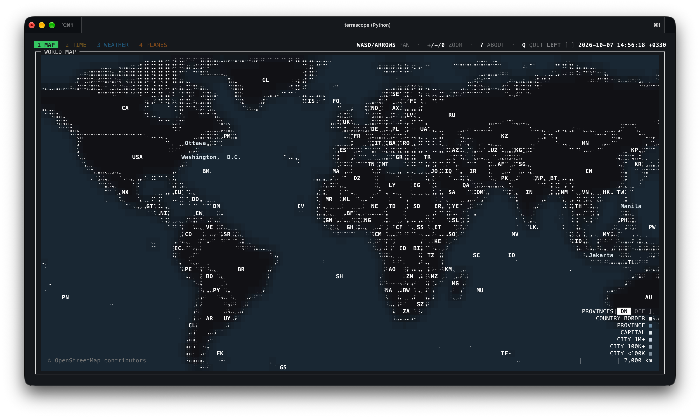

*Global map view.*

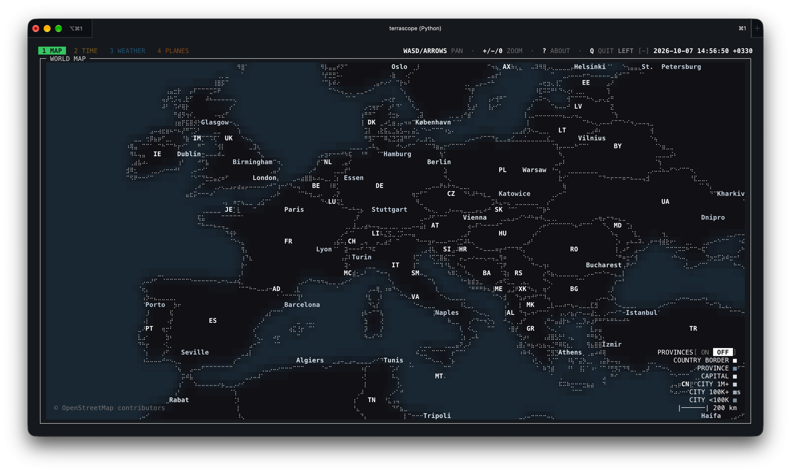

*Europe close-up without province boundaries.*

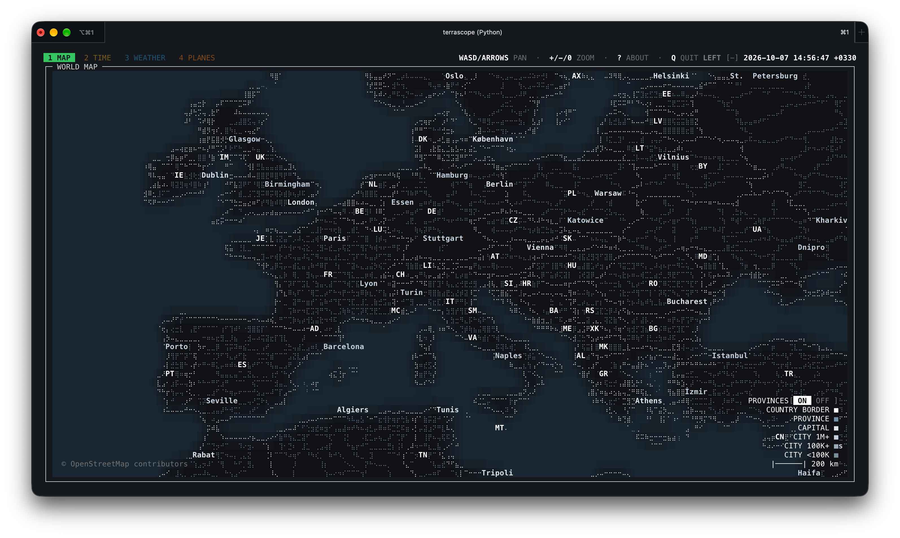

*Europe close-up with province boundaries.*

### Time

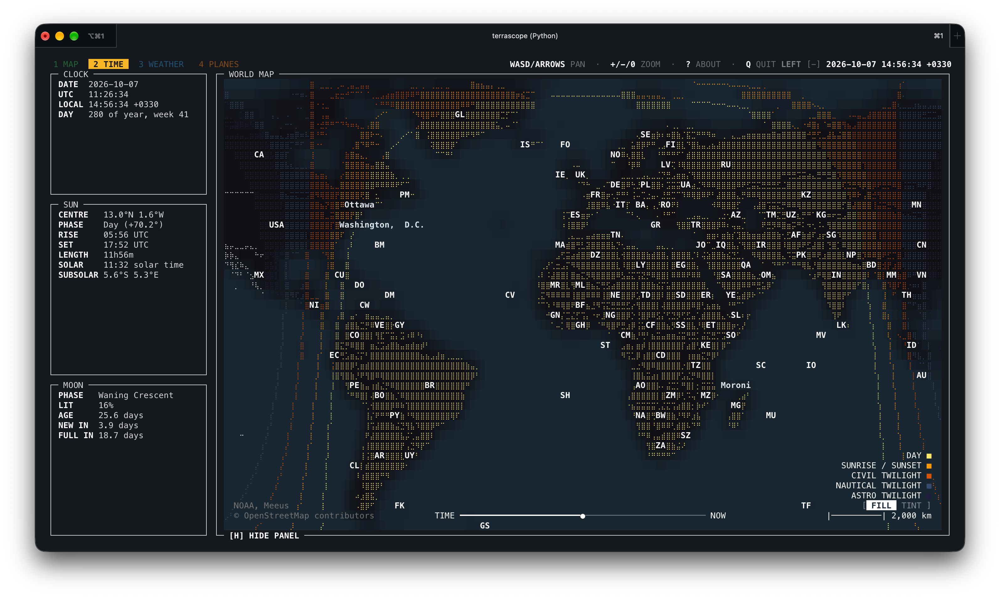

*Global view with day and night fill.*

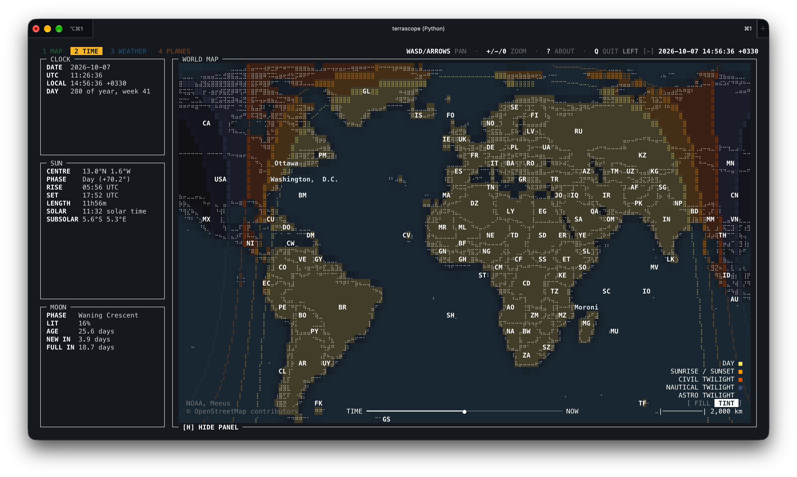

*Global view with day and night tint.*

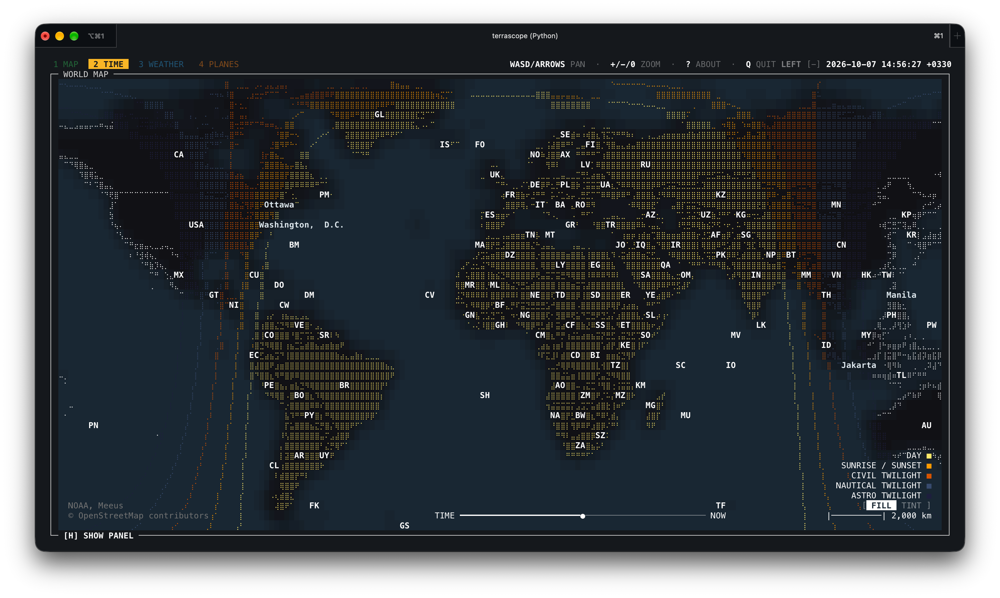

*Global view with fill and the panel hidden.*

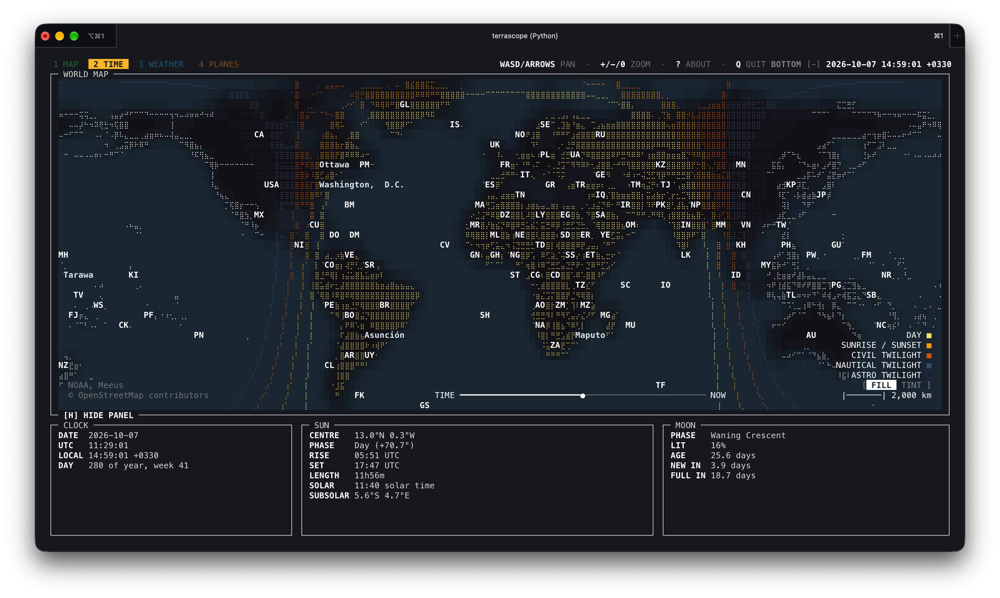

*Time tab with the horizontal panel layout.*

### Weather

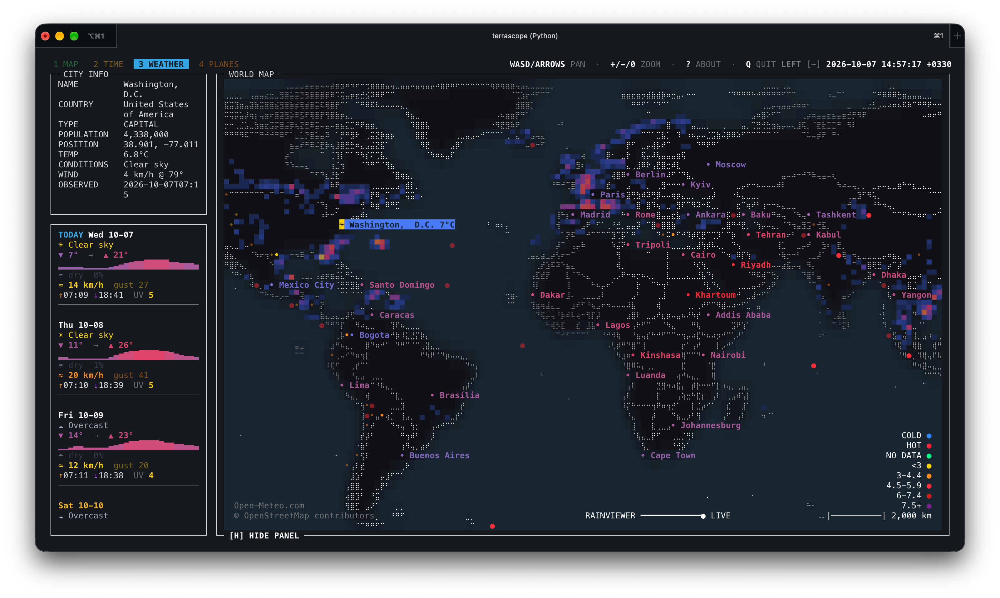

*Global weather view with the vertical panel.*

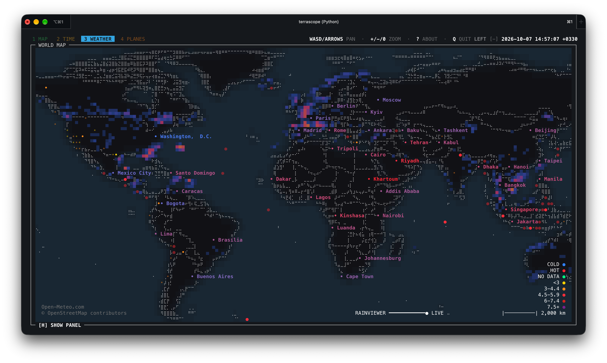

*Global weather view with the panel hidden.*

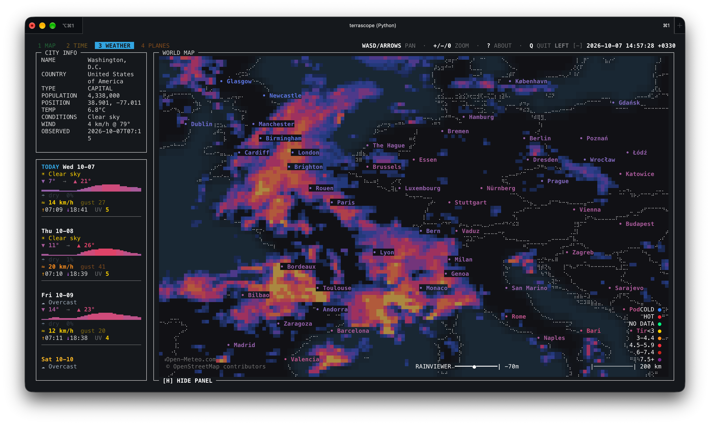

*Europe close-up with the radar overlay.*

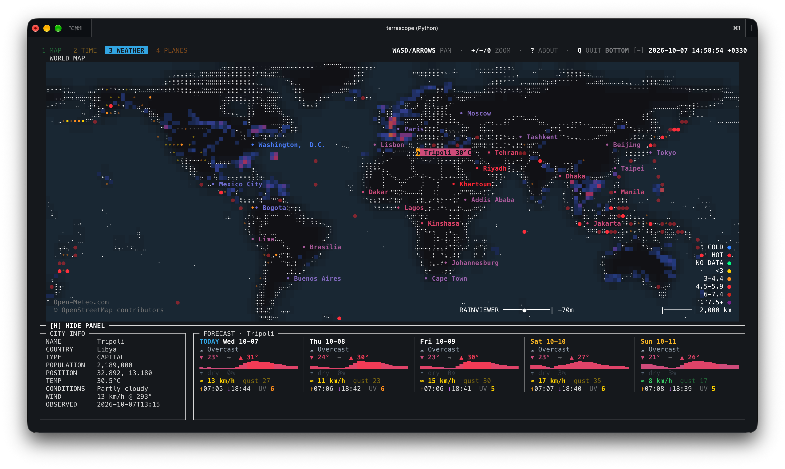

*Weather tab with the horizontal panel layout.*

### Planes

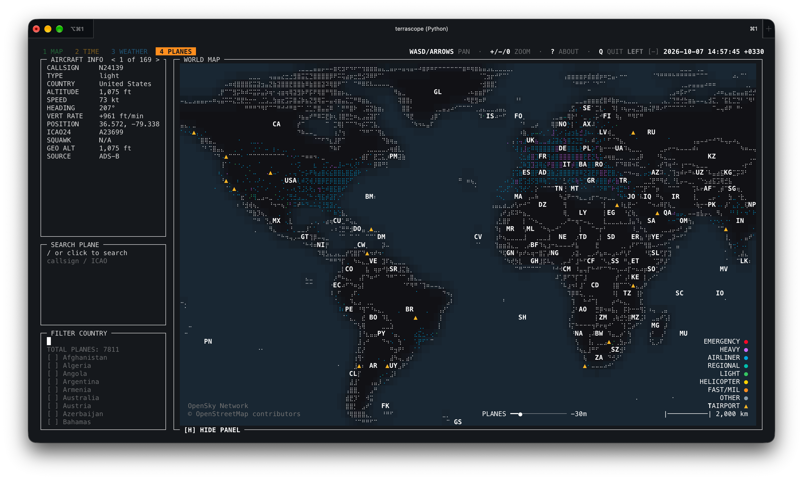

*Global aircraft view.*

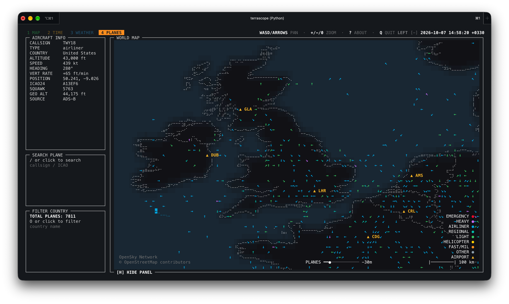

*Aircraft close-up over the United Kingdom.*

## Configuration

Defaults live in:

```text
~/.config/terrascope/default.yaml
```

On first launch, Terrascope copies the bundled defaults to this location and
loads that user-owned copy. Existing files are kept across upgrades. If
`XDG_CONFIG_HOME` is set, Terrascope uses `$XDG_CONFIG_HOME/terrascope/default.yaml`.

You can override settings without editing the package:

```bash
terrascope --config ~/terrascope.yaml
terrascope --set 'map.zoom.max=128'
terrascope --set 'map.land_color="#101018"'
terrascope --set 'app.keys.timezone="t"'
```

The timezone picker shortcut defaults to `Z` and works on the Time tab. Set
`app.keys.timezone` in your config to a different character or list of
characters if you prefer another binding. `terrascope --list-keys` shows the
effective shortcut.

Inspect the final merged config:

```bash
terrascope --dump-config
```

Important environment variables:

| Variable | Meaning |
| --- | --- |
| `terrascope_OFFLINE=1` | Disable live network requests |
| `terrascope_CONFIG=/path/file.yaml` | Load a config file before CLI flags |
| `terrascope_RAINVIEWER_URL=https://...` | Override the RainViewer catalog API |
| `XDG_CACHE_HOME=/path` | Change the default cache root |

## Project Layout

```text
src/terrascope/
  __main__.py              python -m terrascope entry point
  assets/                  default configuration and bundled reference data
  core/
    app/                   app lifecycle, input, mouse, and rendering mixins
    ui/                    colors, layout, dialogs, and map drawing
    cli.py config.py       command-line and settings validation
    mapdata.py world.py    geographic data and map state
  layers/
    basemap/               country outlines, labels, and map detail
    daynight/              day/night rendering and astronomy calculations
    flights/               OpenSky API, cache, formatting, and aircraft layer
    weather/               weather, radar, forecast, and earthquake modules
```

The public console entry point is:

```toml
terrascope = "terrascope.__main__:run"
```

## Data Sources

- Natural Earth: country and province/state outlines, populated places
- OpenSky Network: aircraft positions
- Open-Meteo: city weather and forecasts
- RainViewer Weather Maps API: past radar tiles (personal/educational use; attribution required)
- USGS GeoJSON feeds: earthquakes
- NOAA/Meeus-style calculations in code: day/night and moon information

Bundled reference data is from [Natural Earth 50m Cultural Vectors](https://www.naturalearthdata.com/downloads/50m-cultural-vectors/), which is public domain.

Each source has its own availability and rate-limit behavior. Use `--offline`
when you want to run only from cached data.

Terrascope has no telemetry or analytics. When live layers are enabled, network
requests go to the configured data providers. Weather requests include the
coordinates of displayed cities; providers also receive your IP address and
the Terrascope User-Agent. `--offline` disables live requests.

## Translations

The interface uses gettext, domain `terrascope`. Brazilian Portuguese (`pt_BR`)
is included. The language is chosen in this order: `--lang`, `app.language` in
the config, the `LANGUAGE` / `LC_ALL` / `LC_MESSAGES` / `LANG` variables, the
Windows interface language, and English. Clock and units follow the language:
24-hour time, °C, km/h, a decimal comma and `dd/mm/yyyy` dates in `pt_BR`.
Override them with `--time-format 24h|12h` and `--units metric|imperial`, or with
`app.time_format` and `app.units` in the config.

Catalogues live in `src/terrascope/locale/<lang>/LC_MESSAGES/terrascope.po`.
The `.mo` files are compiled at build time (`hatch_build.py`, with Babel) and are
not kept in git. To add a language:

```bash
pip install babel
pybabel extract -F babel.cfg -k N_ -o src/terrascope/locale/terrascope.pot .
pybabel init -i src/terrascope/locale/terrascope.pot -d src/terrascope/locale -l de_DE -D terrascope
# translate src/terrascope/locale/de_DE/LC_MESSAGES/terrascope.po, then:
pybabel compile -D terrascope -d src/terrascope/locale
```

To check a layout with a pseudo-language (accented, 30% longer text):

```bash
python tools/pseudo_locale.py /tmp/pseudo
terrascope_LOCALE_DIR=/tmp/pseudo terrascope --lang xx
```

## Development Checks

Basic syntax check:

```bash
python3 -m compileall -q src/terrascope
```

If dependencies are installed, a quick import smoke test is:

```bash
PYTHONPATH=src python3 -c "from terrascope.core.registry import build_layers; print([l.name for l in build_layers()])"
```

## Releasing

Versioned tags build and publish the wheel and source distribution to PyPI,
plus standalone `.tar.gz`, `.deb`, `.rpm`, and `.AppImage` downloads for each
platform. The AUR `terrascope` and `terrascope-git` packages are published
from `packaging/aur/`. See
[docs/RELEASING.md](docs/RELEASING.md) for the release and Git steps.


[](https://app.repohistory.com/star-history)
## License

MIT. See `LICENSE`.
